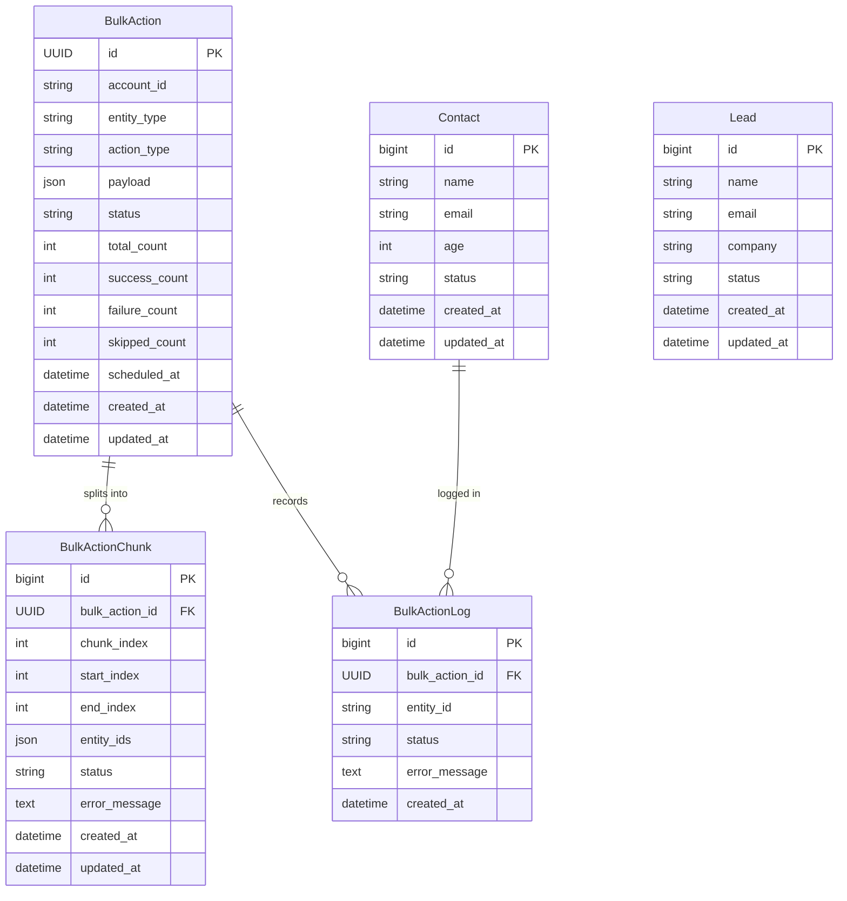
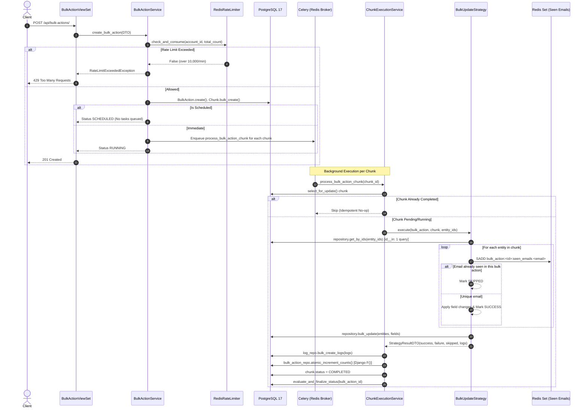

# System Architecture

The Bulk Action Platform is designed according to a strict **Layered Architecture** with downward dependency flow:

```
HTTP Request
      │
      ▼
View / ViewSet         (Thin: HTTP validation, serializer mapping, response output)
      │
      ▼
Service Layer          (Business rules, orchestration, transactions, rate limiting)
      │
      ▼
Repository Layer       (Exclusive ORM database operations, bulk methods, atomic updates)
      │
      ▼
Django Models          (PostgreSQL 17 persistence schema)
```

---

## Architectural Layers & Responsibilities

| Layer | Component | Responsibility | Restrictions |
|---|---|---|---|
| **Presentation** | `BulkActionViewSet` | Validates HTTP requests, maps to DTOs, returns standard JSON / HTTP responses. | **Never** queries ORM directly or contains business rules. |
| **Service** | `BulkActionService`, `ChunkExecutionService` | Orchestrates repositories, enforces multi-tenant rate limits, splits chunks, schedules Celery tasks, handles idempotency. | **Never** accesses HTTP request objects or returns DRF responses. |
| **Strategy** | `BulkUpdateStrategy`, `StrategyFactory` | Implements pluggable execution strategies for entities. | Follows Modular Strategy Pattern. |
| **Registry** | `EntityRegistry` | Decouples action strategies from concrete models to achieve entity agnosticism. | Maps entity types to metadata and repositories. |
| **Repository** | `BulkActionRepository`, `BulkActionChunkRepository`, `BulkActionLogRepository`, `ContactRepository`, `LeadRepository` | Owns 100% of database queries. Utilizes `bulk_update()`, `bulk_create()`, `id__in`, and Django `F()` expressions. | **Never** makes business decisions or manages transactions. |
| **Model** | `BulkAction`, `BulkActionChunk`, `BulkActionLog`, `Contact`, `Lead` | Relational tables, indexes, constraints, and deterministic helper properties. | No business orchestration or external calls. |
| **DTO** | `BulkActionCreateDTO`, `StrategyResultDTO`, `ChunkExecutionDTO`, `BulkActionStatsDTO` | Typed frozen dataclasses for inter-layer data transfer. | Immutable data carrier crossing boundaries. |

---

## Entity Relationship Diagram



---

## Action Lifecycle & Execution Flow


