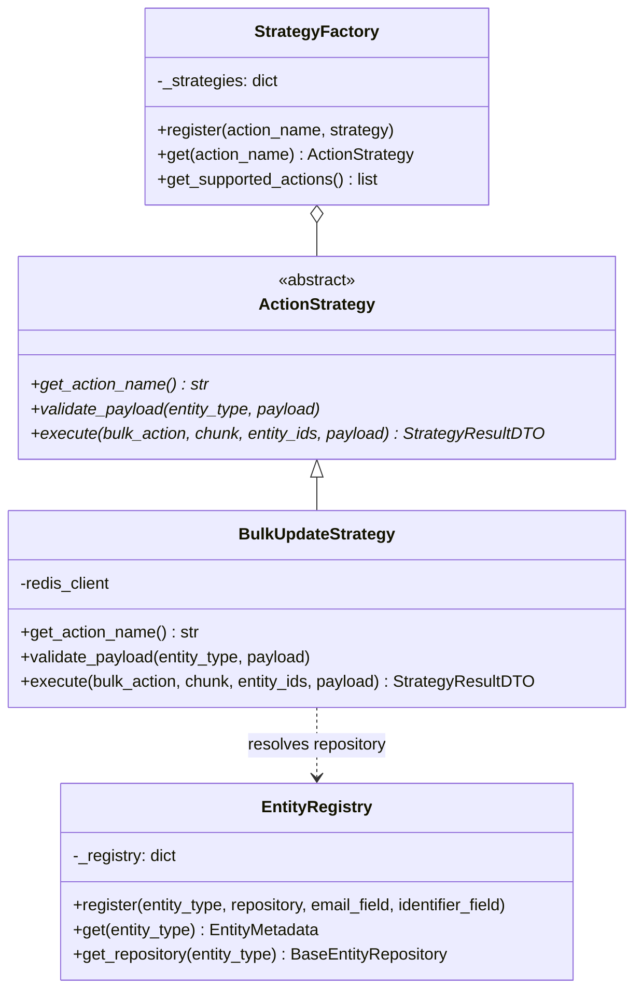

# Modular Strategy Pattern & Entity Agnosticism

A cornerstone of the Bulk Action Platform is its **Entity-Agnostic** design powered by the **Modular Strategy Pattern**. 

Operations like bulk updates, bulk deletions, or exports are decoupled from concrete database models. This ensures that new models (such as `Lead`, `Deal`, or `Account`) can be added with minimal code, while new operations can be introduced without modifying existing business orchestration.

---

## Pattern Overview



---

## 1. ActionStrategy Base Class

Defined in `apps.bulk_actions.strategies.base.ActionStrategy`:

```python
class ActionStrategy(ABC):
    @abstractmethod
    def get_action_name(self) -> str:
        """Return the unique string name for this action strategy."""
        pass

    @abstractmethod
    def validate_payload(self, entity_type: str, payload: dict[str, Any]) -> None:
        """Validate payload schema and field names before queuing."""
        pass

    @abstractmethod
    def execute(
        self,
        bulk_action: BulkAction,
        chunk: BulkActionChunk,
        entity_ids: list[Any],
        payload: dict[str, Any],
    ) -> StrategyResultDTO:
        """Execute the strategy on a chunk of entities."""
        pass
```

---

## 2. EntityRegistry (Entity Agnostic Design)

The `EntityRegistry` maps an entity string (e.g., `'contact'`, `'lead'`) to its corresponding Django model, repository, and deduplication configuration:

```python
@dataclass(frozen=True)
class EntityMetadata:
    entity_type: str
    model_class: Type[Model]
    repository: BaseEntityRepository
    email_field: Optional[str] = "email"
    identifier_field: str = "id"
```

### How to Add a New Entity in < 10 Lines of Code

Suppose you want to introduce a `Deal` entity to support bulk updating deals.

#### Step 1: Define Model & Repository
```python
# apps/entities/models.py
class Deal(models.Model):
    title = models.CharField(max_length=255)
    stage = models.CharField(max_length=50, default="lead")
    value = models.DecimalField(max_digits=12, decimal_places=2)
    contact_email = models.EmailField(db_index=True)


# apps/entities/repositories.py
class DealRepository(BaseEntityRepository[Deal]):
    def get_model_class(self) -> type[Deal]:
        return Deal
```

#### Step 2: Register in `EntityRegistry`
```python
# apps/entities/registry.py
EntityRegistry.register("deal", DealRepository(), email_field="contact_email")
```

That's it! The existing `BulkUpdateStrategy` can now immediately execute bulk updates on the `deal` entity type:
```json
POST /api/bulk-actions/
{
  "account_id": "sales_team_1",
  "entity_type": "deal",
  "action_type": "bulk_update",
  "payload": {
    "entity_ids": [1, 2, 3],
    "fields": {
      "stage": "negotiation"
    }
  }
}
```

---

## 3. How to Add a New Action Strategy

Suppose you want to implement a `BulkDeleteStrategy`.

#### Step 1: Implement `ActionStrategy`
```python
# apps/bulk_actions/strategies/bulk_delete.py
class BulkDeleteStrategy(ActionStrategy):
    def get_action_name(self) -> str:
        return "bulk_delete"

    def validate_payload(self, entity_type: str, payload: dict[str, Any]) -> None:
        # e.g., optional soft-delete flags
        pass

    def execute(self, bulk_action, chunk, entity_ids, payload) -> StrategyResultDTO:
        repository = EntityRegistry.get_repository(bulk_action.entity_type)
        entities = repository.get_by_ids(entity_ids)
        count = entities.count()
        entities.delete()

        logs = [EntityLogEntryDTO(entity_id=str(eid), status="SUCCESS") for eid in entity_ids]
        return StrategyResultDTO(success_count=count, failure_count=0, skipped_count=0, logs=logs)
```

#### Step 2: Register in `StrategyFactory`
```python
# apps/bulk_actions/strategies/factory.py
StrategyFactory.register("bulk_delete", BulkDeleteStrategy())
```

The system automatically supports `action_type="bulk_delete"` across all registered entities with rate limiting, chunking, and logging included out of the box.
